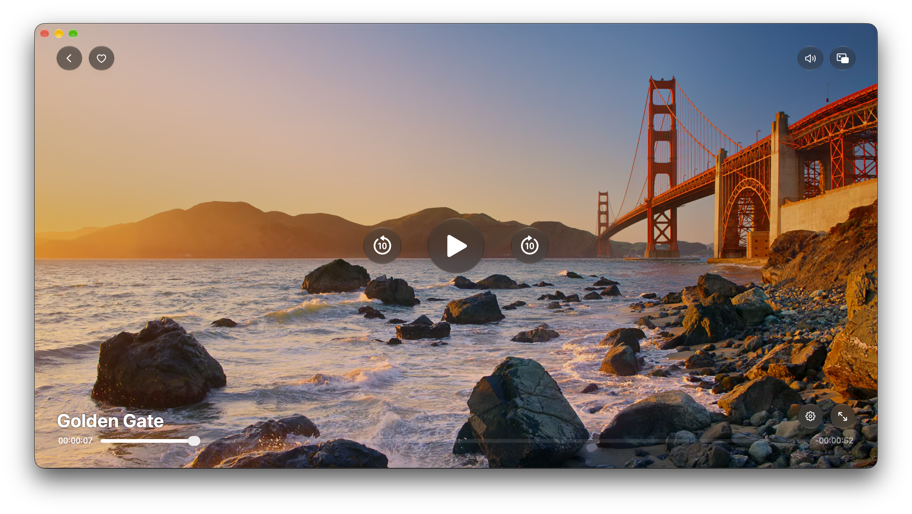

# Vidp

A minimal, keyboard-driven macOS video player built on [libmpv](https://mpv.io), written in Swift/AppKit.
No Electron, no bloat — just a fast native player that plays nearly anything mpv can.



## Install

### via Homebrew (recommended)

```sh
brew tap mdopeace/vidp
brew install --cask vidp
```

Installs `vidp.app` to `/Applications`. The `--cask` flag is optional — plain
`brew install vidp` finds it too.

There is no manual copy step and no compiler: a cask writes to `/Applications`
directly, and the app bundles its own libmpv and FFmpeg, so `brew install mpv`
is not needed to run it.

To update to a newer release:

```sh
brew update && brew upgrade vidp
```

Then launch:

```sh
open /Applications/vidp.app
```

Or let the app update itself with **Check for Updates**. Both routes install the
same build, and Homebrew tracks its own record of the installed version, so that
record can fall out of step with an in-app update. `brew reinstall --cask vidp`
re-points it at the tap's version — which rolls the app back if the tap hasn't
published that version yet, so check `brew info --cask vidp` first if you just
updated in-app.

> **Apple Silicon only.** Releases are arm64, so the prebuilt binary won't run on
> Intel. Build from source below if you need x86_64.
>
> Because libmpv and FFmpeg are bundled, an update ships a new copy of them —
> expect a ~25 MB download per upgrade.

### Migrating from the formula

Releases before 0.13.0 shipped a formula, which installed under `opt/` and asked
you to copy the app into `/Applications` by hand. This tap now ships a cask.

On Homebrew 5.0.6+ `brew update` migrates the formula to the cask for you. It
fails if a copy is already sitting in `/Applications` — exactly what the old
manual step left behind — and the old formula keg keeps `mpv` pinned as a
dependency. Remove both first:

```sh
rm -rf /Applications/vidp.app
brew uninstall --formula vidp
brew install --cask vidp
```

### from source

Requires [Homebrew](https://brew.sh), Xcode Command Line Tools (`swiftc`, `sips`),
and libmpv:

```sh
brew install mpv
./scripts/build.sh        # produces ./vidp.app
open vidp.app
```

## Requirements

- macOS 13+ (Apple Silicon for prebuilt releases; Intel can build from source)

Building from source additionally needs [Homebrew](https://brew.sh), the Xcode
Command Line Tools, and libmpv (`brew install mpv`). Release builds bundle
libmpv into the app itself, so end users need none of this.

## Features

- Native AppKit UI rendering video via mpv/OpenGL
- Keyboard-driven controls and a minimal on-screen HUD
- Now-playing integration with macOS MediaPlayer
- Supports common video formats: mp4, m4v, mov, mkv, webm, avi
- Reads media from files or the Finder ("Open With")
- Check for updates via GitHub API (automatic on launch + manual menu item)
- Uninstall support with full cleanup or app-only removal

## Notes

- The app is ad-hoc signed, not notarized. Cask installs strip the quarantine
  attribute automatically, so they open normally; a `.zip` you download and
  unzip by hand needs `xattr -dr com.apple.quarantine /Applications/vidp.app`
  (or right-click → Open) on first launch.
- macOS asks for permission the first time you open a video from **Desktop**,
  **Documents** or **Downloads**. Choose **Allow**, or playback will silently
  sit there doing nothing until you do. Files elsewhere aren't affected.
- Contributions and issues are welcome, but `main` is branch-protected —
  please open a pull request.

## License

[MIT](LICENSE) © 2026 Md Mostafijur Rahman.

This project links against [libmpv](https://mpv.io), which remains under its own
[LGPL/GPL license](https://github.com/mpv-player/mpv/blob/master/Copyright).
Release builds ship copies of libmpv, FFmpeg and their dependencies inside the
app bundle; see [LICENSES.md](LICENSES.md) for those, and note that
`rubberband`, `x264` and `x265` are GPL-2.0-or-later, which puts the distributed
app under GPL terms.

## Links

- Homepage: <https://mdopeace.github.io/vidp/>
- Homebrew tap: [mdopeace/homebrew-vidp](https://github.com/mdopeace/homebrew-vidp)
- Releases: <https://github.com/mdopeace/vidp/releases>

## Releases

Changes ship to Homebrew users as versioned releases, not per-commit. To cut a
release, run the **Release** workflow from the Actions tab. Pick a Patch/Minor/
Major bump, or type an exact version to override the bump. The run reads the
current version from `Info.plist` and handles the full flow: version bump via
PR, tag, build on a macOS runner, GitHub Release, then the Homebrew tap cask.

From the terminal, `gh workflow run release.yml -f bump=minor` does the same.

One-time setup: the workflow pushes to the tap using the repository secret
`HOMEBREW_TAP_TOKEN` (Settings → Secrets and variables → Actions). It needs
write access to `mdopeace/homebrew-vidp` — the default `GITHUB_TOKEN` cannot
reach another repo, so without it the release publishes and only the tap
update fails.

Users then update with `brew update && brew upgrade vidp`.
